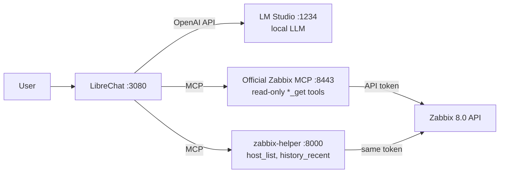

# Zabbix MCP + a local LLM

**English** · [Türkçe](README.tr.md)

Ask Zabbix questions in plain language to a small LLM running on your own machine. No cloud,
no API bill. This repository contains:

- a **Docker stack**: Zabbix 8.0, the **official Zabbix MCP server**, and LibreChat connected
  to a model in LM Studio
- **zabbix-helper**, a small MCP server I wrote so that 4B-class models answer **correctly
  and fast**
- a **reproducible benchmark** that measures this with automatic grading against the Zabbix API



## Why this was needed

Zabbix 8.0 ships an official MCP server. It works, but with a small local model (tested on a
MacBook Pro M4 with 16 GB RAM) the answers were wrong, empty, or took minutes:

| Problem | What happened |
|---|---|
| **Unix timestamps** | `history_get` requires `time_from` / `time_till` as Unix time. Qwen3.5 4B knew the date (`2026-11-06T12:33Z`) but converted it to `1732068549`, which is **November 2024**. Zabbix rejected it ("earlier than 7 days ago") and the model looped on the same wrong arithmetic for 4 minutes. |
| **Huge tool responses** | `host_get` returns every host with all of its triggers: **~16 KB (~4,500 tokens) for a single host** with 83 triggers. With `MaxResponseSize=16K` the result came back empty and the model said "there are 0 hosts". At 32K only about two hosts fit. |
| **Numbers reinterpreted** | The model read a raw average of `0.8166` as **"81.66 %"**. |
| **Lost in large contexts** | Searching items without a host ID returns template items too (65 results, ~15k tokens). The model then thought for 6,000 tokens and returned nothing. |

These are not prompt problems: a 4B model cannot reliably do date arithmetic or averages, and
the more tokens a tool returns, the more likely it gets lost.

## The fix: zabbix-helper

A ~200-line MCP server ([`zabbix-helper/server.py`](zabbix-helper/server.py)) that does the
work the model cannot do, and returns short, ready-to-quote answers:

| Tool | Replaces | What it does |
|---|---|---|
| `host_list` | `host_get` | Returns only ID, names, status and agent availability (~200 characters instead of ~16,000). Does not break as you add hosts. |
| `history_recent` | `history_get` | The model only says "last 60 minutes". The server computes the time range, finds the value type and returns **min / avg / max / last** with units (`"0.78 %"`, `"6.34 GB"`). |

Design choices:

- **Stores no token.** It forwards the client's `Authorization: Bearer` header to the Zabbix
  API, so Zabbix enforces the same read-only permissions as for the official MCP server.
- **Calls the Zabbix API directly**, so it is not bound by the MCP server's response size limit.
- The official Zabbix MCP server stays in place for everything else (problems, triggers, items).

## Results

Same four questions, same agent instructions. The only difference is the tool set:
**official** gives the model the official MCP tools; **helper** swaps `host_get` / `history_get` for
`host_list` / `history_recent`.

- **History questions** (CPU over the last hour, memory over the last 24 hours): no model answered
  a single one correctly with the official tools. With zabbix-helper: **9 of 16** correct.
- **Qwen3.5 4B**: from **6/12 to 10/12**, and the median time per question dropped from
  **73 s to 13 s**.
- Host count and active problems were answered correctly every time with both tool sets. The
  official server is fine for simple lookups.

| Model | Tool set | Host count | Active problems | CPU, last 1 h | Memory, last 24 h | Total | Median time |
|---|---|---|---|---|---|---|---|
| Qwen3.5 4B | official | 3/3 (27 s) | 3/3 (13 s) | 0/3 (117 s) | 0/3 (172 s) | **6/12** | 73 s |
| Qwen3.5 4B | **helper** | 3/3 (7 s) | 3/3 (8 s) | 2/3 (79 s) | 2/3 (20 s) | **10/12** | **13 s** |
| Qwen3 4B 2507 | official | 2/2 (21 s) | 2/2 (7 s) | 0/2 (32 s) | 0/2 (33 s) | **4/8** | 22 s |
| Qwen3 4B 2507 | **helper** | 2/2 (7 s) | 2/2 (6 s) | 0/2 (8 s) | 2/2 (12 s) | **6/8** | 7 s |
| Qwen3 4B Thinking 2507 | official | 1/1 (81 s) | 1/1 (48 s) | 0/1 (240 s) | 0/1 (240 s) | **2/4** | 160 s |
| Qwen3 4B Thinking 2507 | **helper** | 1/1 (38 s) | 1/1 (54 s) | 0/1 (170 s) | 0/1 (198 s) | **2/4** | 112 s |
| Gemma 4 12B | official | 2/2 (103 s) | 2/2 (36 s) | 0/2 (240 s) | 0/2 (240 s) | **4/8** | 180 s |
| Gemma 4 12B | **helper** | 2/2 (35 s) | 2/2 (29 s) | 1/2 (85 s) | 2/2 (63 s) | **7/8** | 48 s |

Cells show *correct / runs (median seconds)*. Each question had a limit of 240 s.

**How it failed with the official tools.** Models computed wrong Unix timestamps that
`history_get` rejected, or kept thinking until the token budget ran out, sometimes before
calling any tool, and returned nothing (Qwen3.5 4B: 5× no answer). Others ran into the 240 s limit (Gemma, Qwen3 Thinking: 6×).
Qwen3 4B 2507 answered quickly but wrongly, and once **made up the values** ("average 45.2 %"; the
real value was 0.71 %).

**How it still fails with zabbix-helper.** All 7 remaining failures happen *before* history is
read, while picking the item:

- Qwen3 4B 2507 searched for "CPU usage", but the item is named "CPU utilization". It found
  nothing and gave up (2×).
- Qwen3 4B Thinking called `item_get` with `limit: 1` and used the first match: *CPU guest nice
  time* and *Available memory*. The values were right, but for the wrong metric (2×).
- Qwen3.5 4B called `item_get` without `hostids` despite the instructions, got template items
  that have no data, and reported "no data" or nothing (2×).
- Gemma picked the right item and the exact maximum, but its average was 0.96 % vs 0.88 %.¹

A tool that maps "CPU" or "memory" to the right item of a host is the obvious next step.

**Recommendation:** Qwen3.5 4B with zabbix-helper scored best and was fastest. Gemma 4 12B is
almost as accurate (7/8), but about 4× slower and uses 6.8 GB of RAM instead of 3.1 GB.

<details>
<summary>Test setup</summary>

- MacBook Pro M4, 16 GB RAM; LM Studio, MLX runtime; all models MLX 4-bit
- Context: 32K for the 4B models, 16K for Gemma 4 12B (to leave memory for Docker on a 16 GB machine)
- Runs per tool set: 3 (Qwen3.5 4B), 2 (Qwen3 4B 2507, Gemma), 1 (Qwen3 Thinking)
- Per question: at most 8 tool-call rounds, 4,096 tokens per model reply, 240 s in total
- Zabbix 8.0.0, one host (*Zabbix server* monitoring itself), no active problems; run on 2026-11-06
- Raw results: [`bench/results/20261106-160552.jsonl`](bench/results/20261106-160552.jsonl)

¹ The Mac went to sleep once during the run. The record that ran while it slept (a timeout shown as
8,367 s) was rerun and timed out again. The Gemma CPU failure above ran right after wake-up,
when the last hour had only 4 samples. One new sample can then shift the average by more than the
8 % tolerance. It is still counted as a failure.

</details>

## Other gotchas found along the way

Things that cost time and are not obvious from the documentation:

1. **Zabbix 8.0 default roles have API access disabled.** The built-in *User role* and *Admin
   role* return `No permissions to call "host.get"`. [`setup_zabbix.py`](setup_zabbix.py)
   creates a role that allows only the 12 read methods behind the MCP tools.
2. **`hostinterface.update` no longer exists in Zabbix 8.0.** Interfaces are changed through
   `host.update` with an `interfaces` array.
3. **LibreChat treats a Bearer-token MCP server as OAuth.** It probes without headers, gets
   `401`, logs `OAuth Required: true` and loads zero tools. Fix: `requiresOAuth: false`.
4. **LibreChat's SSRF protection blocks MCP servers on private networks.** Add them to
   `mcpSettings.allowedAddresses` as `host:port`.
5. **The Zabbix MCP Docker image uses indexed tool rules**: `ZBX_ALLOWTOOL_REGEXP_0`,
   `ZBX_DENYTOOL_1`, ... (one shared sequence, no gaps). In Docker Compose a `$` in a regexp must
   be written as `$$`.
6. **`ZBX_MAX_RESPONSE_SIZE=16K` silently empties `host_get`** for a host with many triggers:
   the response says `truncated: true` with zero results, and models report "0 hosts".
7. **Small models need the current date.** LibreChat replaces `{{iso_datetime}}` in agent
   instructions with the real date on every message.

## Quick start

Requirements: Docker (tested with OrbStack on macOS), Python 3, and
[LM Studio](https://lmstudio.ai) with its local server enabled on port 1234.

```bash
git clone https://github.com/enderkus/zabbix-mcp-local-llm.git
cd zabbix-mcp-local-llm

# 1. Configuration: fill in the secrets (openssl commands are in the files)
cp .env.example .env
cp librechat.env.example librechat.env

# 2. Start Zabbix, the official MCP server and zabbix-helper
docker compose up -d zabbix-db zabbix-server zabbix-web zabbix-agent zabbix-mcp zabbix-helper

# 3. Create the read-only mcp-reader user, its role and API token (written to librechat.env)
python3 -I setup_zabbix.py

# 4. Start LibreChat
docker compose up -d librechat
```

Then:

1. In **LM Studio**, load `qwen3.5-4b-mlx` (Qwen3.5 4B, MLX 4-bit) with a **32K context**.
2. Open http://localhost:3080 and register. The first user becomes admin. Then set
   `ALLOW_REGISTRATION=false` in `librechat.env` and run `docker compose up -d librechat`.
3. Create an **agent** in LibreChat:
   - Model: *LM Studio* → `qwen3.5-4b-mlx`
   - Tools: `host_list` and `history_recent` from **zabbix-helper**; `item_get`, `problem_get`
     and `trigger_get` from **zabbix**
   - Instructions (used in the benchmark, Turkish answers):

     ```
     Sen bir Zabbix asistanısın. Şu anki tarih ve saat: {{iso_datetime}}.
     - Zabbix ile ilgili her soruda önce araç çağır, asla tahmin etme.
     - Host saymak, listelemek veya host ID bulmak için host_list kullan. item_get'i her zaman hostids ile çağır.
     - Geçmiş değer sorularında (son 1 saat, son 1 gün gibi) history_recent kullan; zaman damgası hesaplama.
     - Trigger tanımlarını problem gibi sunma; aktif problemler için problem_get kullan.
     - Cevapları kısa ve Türkçe ver.
     ```

     English version (not benchmarked):

     ```
     You are a Zabbix assistant. Current date and time: {{iso_datetime}}.
     - For every Zabbix question, call a tool first; never guess.
     - Use host_list to count or list hosts or to find a host ID. Always call item_get with hostids.
     - For history questions (last hour, last day, ...) use history_recent; do not compute timestamps.
     - Do not present trigger definitions as problems; use problem_get for active problems.
     - Keep answers short.
     ```

## Reproducing the benchmark

```bash
# one model and tool set (the model must be loaded in LM Studio)
python3 -I bench/run_bench.py --model qwen3.5-4b-mlx --toolset helper --runs 3

# the full matrix: loads each model in turn with lms, then prints the summary table
bash bench/run_all.sh

# summary table of existing results
python3 -I bench/run_bench.py --report bench/results/*.jsonl
```

Each question is sent with the tool definitions and the agent instructions above. Tool calls
are executed for real, and the final answer is graded against values read from the Zabbix API
right after the run (host count and names; "no problems"; average **and** maximum within ±8 %).
Raw results, including every tool call and answer, are in [`bench/results/`](bench/results/).

## Security notes

- Everything is **read-only**: the MCP server exposes only `*_get` tools, and the token belongs
  to a user whose role allows only 12 read API methods. zabbix-helper uses the same token.
- MCP ports are bound to `127.0.0.1`; the web UIs too, unless you set `BIND_ADDR`.
- **Change the Zabbix `Admin` / `zabbix` password** before exposing anything.
- Secrets live in `.env` and `librechat.env`, which are git-ignored.

## Limitations

- Tested on one machine (MacBook Pro M4, 16 GB) with a lab Zabbix that monitors only itself.
  Numbers will differ on other hardware and on real environments with many hosts.
- A 4B model still makes mistakes. Check important values in the Zabbix UI
  (*Monitoring → Latest data*).
- zabbix-helper is not an official Zabbix component; it may need updates for future Zabbix
  API changes.

## License

[MIT](LICENSE) © 2026 Ender KUŞ
