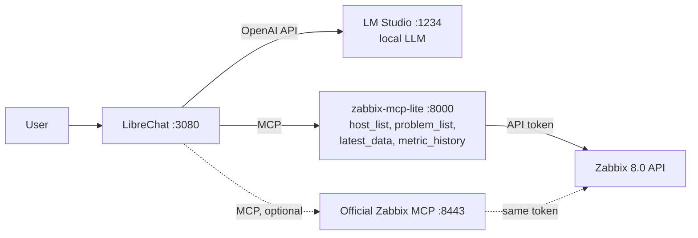

# zabbix-mcp-lite: Zabbix MCP for small local LLMs

**English** · [Türkçe](README.tr.md)

Ask Zabbix questions in plain language to a small LLM running on your own machine. No cloud,
no API bill. This repository contains:

- **zabbix-mcp-lite**: an MCP server for Zabbix 8.0 built for 4B-class models. The model only
  says *"cpu, last 60 minutes"*. The server finds the item, works out the time range and computes
  the statistics.
- a **Docker stack**: Zabbix 8.0, zabbix-mcp-lite, the official Zabbix MCP server (for
  comparison) and LibreChat connected to a model in LM Studio
- a **reproducible benchmark** that grades the answers automatically against the Zabbix API



## Why this was needed

Zabbix 8.0 ships an official MCP server. It works, but with a small local model (tested on a
MacBook Pro M4 with 16 GB RAM) the answers were wrong, empty, or took minutes:

| Problem | What happened |
|---|---|
| **Unix timestamps** | `history_get` requires `time_from` / `time_till` as Unix time. Qwen3.5 4B knew the date (`2026-11-06T12:33Z`) but converted it to `1732068549`, which is **November 2024**. Zabbix rejected it ("earlier than 7 days ago") and the model looped on the same wrong arithmetic for 4 minutes. |
| **Huge tool responses** | `host_get` returns every host with all of its triggers: **~16 KB (~4,500 tokens) for a single host** with 83 triggers. With `MaxResponseSize=16K` the result came back empty and the model said "there are 0 hosts". At 32K only about two hosts fit. |
| **Picking the item** | A host has ~150 items, and 15 of them contain "CPU". Models searched for "CPU usage" (the item is called *CPU utilization*), took the first match (*CPU guest nice time*), or searched without a host and got template items with no data. |
| **Numbers reinterpreted** | A model read a raw average of `0.8166` as **"81.66 %"**. |
| **Lost in large contexts** | Searching items without a host ID returned 65 results (~15k tokens). The model then thought for 6,000 tokens and returned nothing. |

Better prompts don't fix this. A 4B model cannot reliably do date arithmetic or averages, or
choose between 15 similar items, and the more tokens a tool returns, the more likely it gets lost.

## zabbix-mcp-lite

A single MCP server ([`zabbix-mcp-lite/server.py`](zabbix-mcp-lite/server.py), ~900 lines of
Python, one dependency) that does the work the model cannot do and returns short,
ready-to-quote answers:

| Tool | Replaces (official) | What it does |
|---|---|---|
| `host_list` | `host_get` | Count, names, monitoring status and agent availability: ~200 characters instead of ~16,000 per host |
| `problem_list` | `problem_get` + `trigger_get` | Active problems with host, severity, start time and duration, plus a one-line summary such as "There are no active problems." With a period in plain words ("last night", "son 6 saat"), what happened then, resolved or not, repeats grouped (the official tools have no event history) |
| `latest_data` | `item_get` | Current values with units for a metric in plain words, an overview of the main metrics of a host, or, without a host, one metric compared across all hosts (highest first) |
| `metric_history` | `item_get` + `history_get` | Min / avg / max / last over the last N minutes. Finds the item and the time range itself |

A fifth tool, `history_recent`, returns the same statistics for explicit item IDs (advanced use).

```text
metric_history(host="Zabbix server", metric="cpu", minutes=60)

{"host": "Zabbix server",
 "range": {"from": "2026-11-06 19:38:05", "till": "2026-11-06 20:38:05", "minutes": 60,
           "timezone": "Europe/Istanbul"},
 "items": [{"itemid": "42269", "name": "CPU utilization", "key": "system.cpu.util",
            "count": 60, "min": "0.47 %", "avg": "0.56 %", "max": "1.41 %", "last": "1.41 %",
            "summary": "CPU utilization: average 0.56 %, maximum 1.41 %, minimum 0.47 %,
                        last 1.41 % (60 values, 2026-11-06 19:38:24 - 2026-11-06 20:37:24)."}]}
```

**How it finds the item.**

- **Plain words map to the standard template items:** *cpu* → `system.cpu.util`, *memory* /
  *ram* → `vm.memory.util`, *disk* → `vfs.fs…[…,pused]`, *network* → bits received and sent.
  The same goes for *load*, *swap*, *uptime*, *processes* and *ping*.
- **Turkish works too, including suffixes:** *işlemci*, *belleği*, *ağ trafiği*,
  *kullanılabilir bellek*.
- **Several disks:** *disk* returns the used-% of every file system, `/` first and then the
  fullest ones. `metric_history` returns up to 4 of them and names the rest in `other_matches`.
  A mount in the question narrows it down: *disk /var*, *"/var'ın doluluğu"*, *disk C:*
  (*/var free* → *FS [/var]: Space: Available*). If the host has no such mount, the error lists
  the file systems it does have.
- **More specific requests fall back to the words in item names and keys:** *cpu iowait* →
  *CPU iowait time*, *available memory* → *Available memory*.
- **Hosts are matched loosely**, so "Zabbix server'ın" also works. With a single host, the host
  can be left out.
- **When nothing matches, the error says what to try** (for example the list of hosts) instead
  of a bare failure.

**Design choices.**

- **Stores no token.** It forwards the client's `Authorization: Bearer` header to the Zabbix API,
  so Zabbix enforces that token's permissions. It only calls read methods: `host.get`,
  `item.get`, `history.get`, `problem.get`, `trigger.get` and `event.get`.
- **Answers carry units** (`0.55 %`, `6.42 GB`, `2.62 Kbps`, `3h 51m`), so the model does not
  reinterpret the numbers.
- **Responses are small by design**, a few hundred characters, so there is no response size
  limit to tune.

## What you can ask

Four tools, but not four questions: `latest_data` and `metric_history` reach every item of every
host the token can read, by plain words.

| You ask | The model calls |
|---|---|
| "How many hosts are there?" "Is any host unreachable?" | `host_list` |
| "Are there any problems?" "Any problems on Zabbix server?" | `problem_list` |
| "How is Zabbix server doing right now?" | `latest_data`: CPU, memory, load, disk, swap, network, uptime, processes, ping |
| "How much free memory is there?" "How much RAM in total?" "How full is the disk?" | `latest_data` / `metric_history` |
| "CPU usage over the last hour?" "Memory over the last 24 hours?" | `metric_history` |
| "Highest load average in the last 24 hours?" "Network traffic in the last hour?" "Swap over the last 3 hours?" | `metric_history` |
| "Which host has the highest CPU?" "Which host has the highest memory usage?" | `latest_data` without a host: one call compares every host, highest first |
| "What happened last night?" "Any problems in the last 6 hours?" | `problem_list` with a period: the server works out the time range |
| Any other item: "cpu iowait", "context switches", "interface errors", ... | `latest_data` / `metric_history`, matched by the words in the item name |

Before writing this list I asked the questions in the first six rows to Qwen3.5 4B with these
tools, plus one about a host that does not exist. The host comparison row was tested later
on three hosts (two with an agent, one without items): in 6 runs every answer used a single
`latest_data` call and matched the tool output (once it called the disks a tie, both showed
23.66 %). The past-problems row was tested after a real 6-minute agent outage: in 10 runs, in
Turkish and English, every answer used one `problem_list` call with the period in the user's
words and listed the right problems (once the model mistranslated a problem name, "100 items"
became "10"). The last row was tested on the tools directly. The first round of 10 questions had 8 right answers and 2 failures:

- One answer quoted the CPU value 0.63 % as "%63". The tool output was right, and reruns were
  correct.
- One answer searched for "swap" when asked about free memory. I then changed the tool
  descriptions to "pass the user's own words", and the same question was answered correctly
  3 of 3 times.

**Why only four tools?** Every tool definition is sent to the model with every message. The
official server's 12 tools take **3,618 tokens**; these four take **1,162** (Qwen3.5 4B
tokenizer). On a laptop that is seconds of extra prompt processing per message, and a small model
chooses better between 4 tools than between 12.

## What it does not do (yet)

- **No changes.** It cannot acknowledge or close problems, create maintenance periods or change
  the configuration. It is read-only on purpose.
- **No configuration questions** such as trigger expressions, templates, macros, users or host
  groups. `host_list` filters by name only.
- **Past problems go back at most 31 days** and are listed by when they started. A problem
  that began before the period and is still open is counted in the summary, not listed.
- **History covers the last 7 days**, from raw history (no trends, no graphs).
- **Host comparison uses current values.** "Which host has the highest CPU right now?" is one
  call; "which host had the highest CPU over the last 24 hours?" still needs a
  `metric_history` call per host.
- **Text and log items** return their last five values only.

Each of these would be a new tool, and every tool costs tokens on every message, so they are
worth adding only where they are needed.

## Results

The same four questions on the same machine, with three tool sets, each with its own agent
instructions:

- **official**: the official MCP server's tools (`host_get`, `item_get`, `problem_get`,
  `trigger_get`, `history_get`)
- **helper**: my first attempt, the official tools plus `host_list` and `history_recent`. The
  model still had to pick the item with `item_get`.
- **lite**: zabbix-mcp-lite alone (`host_list`, `problem_list`, `latest_data`, `metric_history`)

Highlights:

- **History questions** (CPU over the last hour, memory over the last 24 hours), all four
  models: **0/16** with the official tools, **9/16** with the first attempt, **16/16** with
  zabbix-mcp-lite.
- **All questions: 32/32** with zabbix-mcp-lite, for every model. That includes Qwen3 4B 2507,
  which made up values with the official tools.
- **Qwen3.5 4B**: 6/12 → 10/12 → **12/12**. The median time per question went from
  **73 s → 13 s → 10 s**, and a history question is usually a single tool call.
- **Gemma 4 12B**: the median time went from 180 s to 23 s.

| Model | Tool set | Host count | Active problems | CPU, last 1 h | Memory, last 24 h | Total | Median time |
|---|---|---|---|---|---|---|---|
| Qwen3.5 4B | official | 3/3 (27 s) | 3/3 (13 s) | 0/3 (117 s) | 0/3 (172 s) | 6/12 | 73 s |
| Qwen3.5 4B | helper | 3/3 (7 s) | 3/3 (8 s) | 2/3 (79 s) | 2/3 (20 s) | 10/12 | 13 s |
| Qwen3.5 4B | **lite** | 3/3 (6 s) | 3/3 (4 s) | 3/3 (11 s) | 3/3 (12 s) | **12/12** | **10 s** |
| Qwen3 4B 2507 | official | 2/2 (21 s) | 2/2 (7 s) | 0/2 (32 s) | 0/2 (33 s) | 4/8 | 22 s |
| Qwen3 4B 2507 | helper | 2/2 (7 s) | 2/2 (6 s) | 0/2 (8 s) | 2/2 (12 s) | 6/8 | 7 s |
| Qwen3 4B 2507 | **lite** | 2/2 (4 s) | 2/2 (4 s) | 2/2 (8 s) | 2/2 (9 s) | **8/8** | **6 s** |
| Qwen3 4B Thinking 2507 | official | 1/1 (81 s) | 1/1 (48 s) | 0/1 (240 s) | 0/1 (240 s) | 2/4 | 160 s |
| Qwen3 4B Thinking 2507 | helper | 1/1 (38 s) | 1/1 (54 s) | 0/1 (170 s) | 0/1 (198 s) | 2/4 | 112 s |
| Qwen3 4B Thinking 2507 | **lite** | 1/1 (18 s) | 1/1 (18 s) | 1/1 (30 s) | 1/1 (53 s) | **4/4** | **24 s** |
| Gemma 4 12B | official | 2/2 (103 s) | 2/2 (36 s) | 0/2 (240 s) | 0/2 (240 s) | 4/8 | 180 s |
| Gemma 4 12B | helper | 2/2 (35 s) | 2/2 (29 s) | 1/2 (85 s) | 2/2 (63 s) | 7/8 | 48 s |
| Gemma 4 12B | **lite** | 2/2 (17 s) | 2/2 (13 s) | 2/2 (30 s) | 2/2 (37 s) | **8/8** | **23 s** |

Cells show *correct / runs (median seconds)*. Each question had a limit of 240 s.

**How it failed with the official tools.** Models computed wrong Unix timestamps that
`history_get` rejected. Others kept thinking until the token budget ran out, sometimes before
calling any tool, and returned nothing (Qwen3.5 4B: 5× no answer). Others ran into the 240 s limit
(Gemma, Qwen3 Thinking: 6×). Qwen3 4B 2507 answered quickly but wrongly, and once **made up the
values** ("average 45.2 %"; the real value was 0.71 %).

**How the first attempt still failed.** `history_recent` removed the timestamp problem, but all
7 remaining failures happened while picking the item:

- Qwen3 4B 2507 searched for "CPU usage" (the item is *CPU utilization*) and gave up (2×).
- Qwen3 4B Thinking used `limit: 1` and got *CPU guest nice time* and *Available memory* (2×).
- Qwen3.5 4B searched without `hostids` and got template items with no data (2×).
- Gemma's average was off by 9 %.¹

zabbix-mcp-lite removes this step: `metric_history(metric="cpu")` picks the item on the server.

**Recommendation:** Qwen3.5 4B with zabbix-mcp-lite: 12/12, about 10 s per answer, 3.1 GB of
RAM. Qwen3 4B 2507 was also 8/8 and a bit faster. Gemma 4 12B is just as accurate, but about
2× slower and uses 6.8 GB.

**Read this with care.** These are four questions on a lab Zabbix with one host, and only 1–3
runs per cell. The plain-word table maps *cpu* and *memory* to the same standard items that the
grader reads. So this shows the whole path works end to end for typical questions, not that
every question will be answered correctly.

<details>
<summary>Test setup</summary>

- MacBook Pro M4, 16 GB RAM; LM Studio, MLX runtime; all models MLX 4-bit
- Context: 32K for the 4B models, 16K for Gemma 4 12B (to leave memory for Docker on a 16 GB machine)
- Runs per tool set: 3 (Qwen3.5 4B), 2 (Qwen3 4B 2507, Gemma), 1 (Qwen3 Thinking)
- Per question: at most 8 tool-call rounds, 4,096 tokens per model reply, 240 s in total
- Zabbix 8.0.0, one host (*Zabbix server* monitoring itself), no active problems
- All runs were on 2026-11-06. *official* and *helper* ran first; *lite* ran about four hours
  later, and its records also contain every tool result.
- Raw results: [`20261106-160552.jsonl`](bench/results/20261106-160552.jsonl) (official,
  helper), [`20261106-202808.jsonl`](bench/results/20261106-202808.jsonl) (lite)
- The *helper* rows were measured with the first version of the server (commit `e7b1fce`)
- The *lite* rows were measured before the several-disks, host comparison and past-problems
  additions (tool definitions then 1,019 tokens, now 1,162). Rechecks with Qwen3.5 4B after
  each change passed 8/8. Since the past-problems change the model calls `host_list` before
  `metric_history` on the 24-hour memory question (4 of 4 recheck runs), about 4 s more.

¹ The Mac went to sleep once during the first run. The record that ran while it slept (a timeout
shown as 8,367 s) was rerun and timed out again. The Gemma CPU failure ran right after wake-up,
when the last hour had only 4 samples. One new sample can then shift the average by more than the
8 % tolerance. It is still counted as a failure.

</details>

## Other gotchas found along the way

Things that cost time and are not obvious from the documentation:

1. **Zabbix 8.0 default roles have API access disabled.** The built-in *User role* and *Admin
   role* return `No permissions to call "host.get"`. [`setup_zabbix.py`](setup_zabbix.py)
   creates a role that allows only the 13 read methods behind the MCP tools.
2. **`hostinterface.update` no longer exists in Zabbix 8.0.** Interfaces are changed through
   `host.update` with an `interfaces` array.
3. **LibreChat treats a Bearer-token MCP server as OAuth.** It probes without headers, gets
   `401`, logs `OAuth Required: true` and loads zero tools. Fix: `requiresOAuth: false`.
4. **LibreChat's SSRF protection blocks MCP servers on private networks.** Add them to
   `mcpSettings.allowedAddresses` as `host:port`.
5. **The Zabbix MCP Docker image uses indexed tool rules**: `ZBX_ALLOWTOOL_REGEXP_0`,
   `ZBX_DENYTOOL_1`, ... (one shared sequence, no gaps). In Docker Compose a `$` in a regexp must
   be written as `$$`.
6. **`ZBX_MAX_RESPONSE_SIZE=16K` silently empties `host_get`** for a host with many triggers:
   the response says `truncated: true` with zero results, and models report "0 hosts".
7. **Small models need the current date.** LibreChat replaces `{{iso_datetime}}` in agent
   instructions with the real date on every message.
8. **The MCP Python SDK 2.x hides exception messages from the model.** Only a `ToolError`
   reaches the client; anything else becomes a bare `Error executing tool <name>`. Errors that
   tell the model what to do next ("Hosts: Zabbix server") must be raised as `ToolError`.

## Quick start

Requirements: Docker (tested with OrbStack on macOS), Python 3, and
[LM Studio](https://lmstudio.ai) with its local server enabled on port 1234.

```bash
git clone https://github.com/enderkus/zabbix-mcp-lite.git
cd zabbix-mcp-lite

# 1. Configuration: fill in the secrets (openssl commands are in the files)
cp .env.example .env
cp librechat.env.example librechat.env

# 2. Start Zabbix and zabbix-mcp-lite
docker compose up -d zabbix-db zabbix-server zabbix-web zabbix-agent zabbix-mcp-lite

# 3. Create the read-only mcp-reader user, its role and API token (written to librechat.env)
python3 -I setup_zabbix.py

# 4. Start LibreChat (also starts the official Zabbix MCP server, which is optional)
docker compose up -d librechat
```

Then:

1. In **LM Studio**, load `qwen3.5-4b-mlx` (Qwen3.5 4B, MLX 4-bit) with a **32K context**.
2. Open http://localhost:3080 and register. The first user becomes admin. Then set
   `ALLOW_REGISTRATION=false` in `librechat.env` and run `docker compose up -d librechat`.
3. Create an **agent** in LibreChat:
   - Model: *LM Studio* → `qwen3.5-4b-mlx`
   - Tools: from **zabbix-lite** only: `host_list`, `problem_list`, `latest_data`,
     `metric_history`
   - Instructions (used in the benchmark, Turkish answers):

     ```
     Sen bir Zabbix asistanısın. Şu anki tarih ve saat: {{iso_datetime}}.
     - Zabbix ile ilgili her soruda önce araç çağır, asla tahmin etme.
     - Hostlar için host_list, aktif problemler için problem_list kullan.
     - Bir metriğin geçmiş değerleri için (son 1 saat, son 24 saat gibi) metric_history, anlık değerleri için latest_data kullan.
     - Araçların döndürdüğü değerleri birimleriyle aynen aktar.
     - Cevapları kısa ve Türkçe ver.
     ```

     English version (not benchmarked):

     ```
     You are a Zabbix assistant. Current date and time: {{iso_datetime}}.
     - For every Zabbix question, call a tool first; never guess.
     - Use host_list for hosts and problem_list for active problems.
     - Use metric_history for values over time (last hour, last 24 hours, ...) and latest_data for current values.
     - Quote the values returned by the tools as they are, with their units.
     - Keep answers short.
     ```

Example questions: *"Are there any active problems?"*, *"How was the CPU usage of Zabbix
server in the last hour?"*, *"Memory over the last 24 hours?"*, *"How is Zabbix server doing
right now?"*, *"Disk usage?"*.

## Using zabbix-mcp-lite with your own Zabbix

The server works with any MCP client that supports streamable HTTP and custom headers:

```bash
docker build -t zabbix-mcp-lite ./zabbix-mcp-lite
docker run -d --name zabbix-mcp-lite -p 127.0.0.1:8001:8000 \
  -e ZABBIX_API_URL=https://zabbix.example.com/api_jsonrpc.php \
  -e TZ=Europe/Istanbul \
  -e ALLOWED_HOSTS=127.0.0.1:8001,localhost:8001 \
  zabbix-mcp-lite
```

- **Endpoint:** `http://127.0.0.1:8001/mcp`, with the header
  `Authorization: Bearer <Zabbix API token>`.
- **The token's user needs API access** to the read methods listed above. See
  [`setup_zabbix.py`](setup_zabbix.py) for a minimal role.
- **Upgrading from an earlier version:** past problems need `event.get`. Re-run
  `python3 -I setup_zabbix.py` (it updates the role and issues a new token), then
  `docker compose up -d`.
- **`ALLOWED_HOSTS`** is the list of `Host` headers the server accepts (DNS rebinding
  protection). Add the name your client uses to reach it.

## Reproducing the benchmark

```bash
# one model and tool set (the model must be loaded in LM Studio)
python3 -I bench/run_bench.py --model qwen3.5-4b-mlx --toolset lite --runs 3

# the full matrix: loads each model in turn with lms, then prints the summary table
caffeinate -i bash bench/run_all.sh          # macOS: keep the machine awake
TOOLSETS=lite bash bench/run_all.sh          # only some tool sets

# summary table of existing results
python3 -I bench/run_bench.py --report bench/results/*.jsonl
```

Each question is sent with the tool definitions and the agent instructions of its tool set
(see `PROMPTS` in [`bench/run_bench.py`](bench/run_bench.py)). Tool calls are executed for
real. The final answer is graded against values read from the Zabbix API right after the run:

- host count and names
- "no problems"
- average **and** maximum within ±8 %

Raw results, including every tool call and answer, are in [`bench/results/`](bench/results/).

## Security notes

- **Everything is read-only.** zabbix-mcp-lite only calls read methods, the official MCP server
  exposes only `*_get` tools, and the token belongs to a user whose role allows only 13 read API
  methods.
- **Ports are bound to `127.0.0.1`.** The MCP ports always are; the web UIs are too, unless you
  set `BIND_ADDR`.
- **Change the Zabbix `Admin` / `zabbix` password** before exposing anything.
- **Secrets live in `.env` and `librechat.env`**, which are git-ignored.

## Limitations

- **Tested on one machine**, a MacBook Pro M4 with 16 GB, with a lab Zabbix that monitors only
  itself. Numbers will differ on other hardware and on real environments with many hosts.
- **The plain-word table targets the standard agent templates** (*Linux by Zabbix agent*,
  *Windows by Zabbix agent*). With other templates (SNMP, cloud), matching falls back to the
  words in item names. That works for English names but is less precise.
- **History covers the last 7 days** and is read from raw history (no trends).
- **A 4B model still makes mistakes**, even with correct tool output (one answer above quoted
  0.63 % as "%63"). Check important values in the Zabbix UI (*Monitoring → Latest data*).
- **zabbix-mcp-lite is not an official Zabbix component.** It may need updates for future
  Zabbix API changes.

## License

[MIT](LICENSE) © 2026 Ender KUŞ
