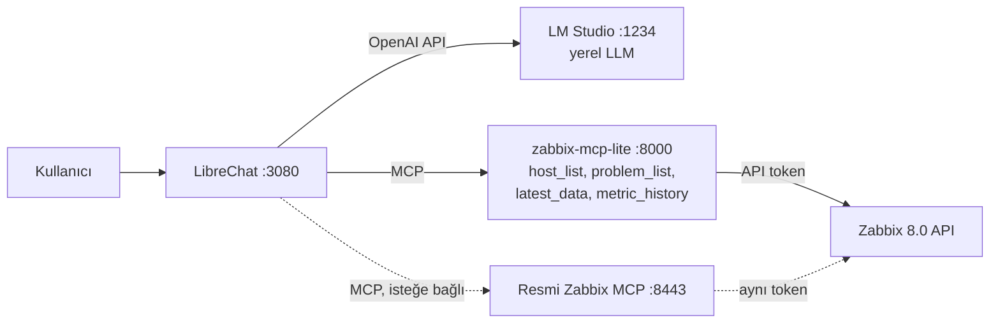

# zabbix-mcp-lite: küçük yerel LLM'ler için Zabbix MCP

[English](README.md) · **Türkçe**

Zabbix'e kendi bilgisayarında çalışan küçük bir dil modeliyle, günlük dilde soru sor. Bulut
yok, API faturası yok. Bu repoda şunlar var:

- **zabbix-mcp-lite**: 4B'lik modeller için tasarlanmış, Zabbix 8.0'a yönelik bir MCP sunucusu.
  Model sadece *"cpu, son 60 dakika"* diyor; item'ı bulmak, zaman aralığını hesaplamak ve
  istatistiği çıkarmak sunucunun işi.
- **Docker yığını**: Zabbix 8.0, zabbix-mcp-lite, karşılaştırma için resmi Zabbix MCP sunucusu
  ve LM Studio'daki modele bağlı LibreChat
- cevapları Zabbix API'ye karşı otomatik puanlayan **tekrarlanabilir bir test**



## Neden gerek oldu

Zabbix 8.0 ile resmi bir MCP sunucusu geliyor. Çalışıyor, ama küçük bir yerel modelle
(16 GB RAM'li MacBook Pro M4 üzerinde test edildi) cevaplar yanlış ya da boş geliyor veya
dakikalar sürüyordu:

| Sorun | Ne oldu |
|---|---|
| **Unix zaman damgası** | `history_get`, `time_from` / `time_till` değerlerini Unix zamanı olarak istiyor. Qwen3.5 4B tarihi biliyordu (`2026-11-06T12:33Z`) ama bunu `1732068549`'a çevirdi; bu **Kasım 2024** demek. Zabbix "7 günden eski olamaz" diye reddetti, model de aynı yanlış hesabı 4 dakika boyunca tekrarladı. |
| **Dev araç cevapları** | `host_get` her host'u tüm trigger'larıyla döndürüyor: 83 trigger'lı **tek bir host bile ~16 KB (~4.500 token)**. `MaxResponseSize=16K` iken sonuç boş geldi ve model "0 host var" dedi. 32K'ya ise ancak 2 host sığıyor. |
| **Item seçimi** | Bir host'ta ~150 item var, 15'inin adında "CPU" geçiyor. Modeller "CPU usage" diye aradı (item'ın adı *CPU utilization*), ilk sonucu aldı (*CPU guest nice time*) ya da host vermeden arayıp verisi olmayan template item'larına takıldı. |
| **Sayıyı yanlış yorumlama** | Bir model ham ortalama `0.8166` değerini **"%81.66"** diye okudu. |
| **Büyük bağlamda kaybolma** | Host ID vermeden yapılan item araması 65 sonuç döndürdü (~15 bin token). Model sonra 6.000 token düşündü ve hiçbir şey döndürmedi. |

Bunlar daha iyi talimatla çözülecek sorunlar değil. 4B'lik bir model tarih hesabını ve
ortalamayı güvenilir yapamıyor, birbirine benzeyen 15 item arasından doğrusunu seçemiyor; araç
ne kadar çok token döndürürse yolunu kaybetme ihtimali de o kadar artıyor.

## zabbix-mcp-lite

Modelin yapamadığı işi kendisi yapan ve kısa, olduğu gibi aktarılabilecek cevaplar dönen tek bir
MCP sunucusu ([`zabbix-mcp-lite/server.py`](zabbix-mcp-lite/server.py); ~750 satır Python, tek
bağımlılık):

| Araç | Resmi sunucuda yerine geçtiği | Ne yapıyor |
|---|---|---|
| `host_list` | `host_get` | Host sayısı, adları, izleme durumu ve agent erişilebilirliği: host başına ~16.000 yerine ~200 karakter |
| `problem_list` | `problem_get` + `trigger_get` | Aktif problemler; host, önem derecesi, başlangıç zamanı, süre ve "There are no active problems." gibi tek satırlık özetle |
| `latest_data` | `item_get` | Günlük dilde söylenen bir metriğin birimli anlık değeri, host'un ana metriklerinin özeti ya da host verilmezse bir metriğin tüm host'larda karşılaştırması (en yüksekten başlayarak) |
| `metric_history` | `item_get` + `history_get` | Son N dakikanın en düşük / ortalama / en yüksek / son değeri. Item'ı ve zaman aralığını kendisi buluyor |

Beşinci araç `history_recent`, aynı istatistiği item ID'leriyle döndürüyor (ileri kullanım için).

```text
metric_history(host="Zabbix server", metric="cpu", minutes=60)

{"host": "Zabbix server",
 "range": {"from": "2026-11-06 19:38:05", "till": "2026-11-06 20:38:05", "minutes": 60,
           "timezone": "Europe/Istanbul"},
 "items": [{"itemid": "42269", "name": "CPU utilization", "key": "system.cpu.util",
            "count": 60, "min": "0.47 %", "avg": "0.56 %", "max": "1.41 %", "last": "1.41 %",
            "summary": "CPU utilization: average 0.56 %, maximum 1.41 %, minimum 0.47 %,
                        last 1.41 % (60 values, 2026-11-06 19:38:24 - 2026-11-06 20:37:24)."}]}
```

**Item'ı nasıl buluyor?**

- **Günlük dildeki sözcükler standart template item'larıyla eşleşiyor:** *cpu* →
  `system.cpu.util`, *memory* / *ram* → `vm.memory.util`, *disk* → `vfs.fs…[…,pused]`,
  *network* → gelen ve giden bit. *load*, *swap*, *uptime*, *processes* ve *ping* de böyle.
- **Türkçe de çalışıyor, ekleriyle birlikte:** *işlemci*, *belleği*, *ağ trafiği*,
  *kullanılabilir bellek*.
- **Birden fazla disk varsa:** *disk* her dosya sisteminin kullanım yüzdesini getiriyor; önce
  `/`, sonra en dolu olanlar. `metric_history` bunlardan en fazla 4'ünü döndürüyor, kalanların
  adını `other_matches` içinde veriyor. Soruda mount geçerse sadece o geliyor: *disk /var*,
  *"/var'ın doluluğu"*, *disk C:* (*/var free* → *FS [/var]: Space: Available*). Host'ta öyle
  bir mount yoksa hata mesajı mevcut dosya sistemlerini listeliyor.
- **Daha özel istekler item adı ve anahtarındaki sözcüklerle eşleşiyor:** *cpu iowait* →
  *CPU iowait time*, *available memory* → *Available memory*.
- **Host adı esnek eşleşiyor**, "Zabbix server'ın" da çalışıyor. Tek host varsa host hiç
  verilmeyebilir.
- **Hiçbir şey eşleşmezse hata mesajı ne denenmesi gerektiğini söylüyor** (örneğin host
  listesini veriyor); sadece "hata" demiyor.

**Tasarım kararları:**

- **Token saklamaz.** İstemcinin `Authorization: Bearer` başlığını Zabbix API'ye iletir;
  yetkileri o token'a göre Zabbix uygular. Sadece okuma metotlarını çağırır: `host.get`,
  `item.get`, `history.get`, `problem.get` ve `trigger.get`.
- **Cevaplar birimli** (`0.55 %`, `6.42 GB`, `2.62 Kbps`, `3h 51m`), böylece model sayıyı
  yanlış yorumlamıyor.
- **Cevaplar baştan küçük**, birkaç yüz karakter. Ayarlanması gereken bir cevap boyutu sınırı
  yok.

## Neler sorabilirsin

Dört araç var ama dört soru değil: `latest_data` ve `metric_history`, token'ın okuyabildiği her
host'un her item'ına günlük dildeki sözcüklerle ulaşıyor.

| Sen soruyorsun | Model şunu çağırıyor |
|---|---|
| "Kaç host var?" "Erişilemeyen host var mı?" | `host_list` |
| "Aktif problem var mı?" "Zabbix server'da problem var mı?" | `problem_list` |
| "Zabbix server şu an nasıl durumda?" | `latest_data`: CPU, bellek, load, disk, swap, ağ, uptime, process, ping |
| "Ne kadar boş bellek var?" "Toplam ne kadar RAM var?" "Disk doluluğu ne kadar?" | `latest_data` / `metric_history` |
| "Son 1 saatte CPU kullanımı?" "Son 24 saatte bellek?" | `metric_history` |
| "Son 24 saatte en yüksek load average?" "Son 1 saatte ağ trafiği?" "Son 3 saatte swap?" | `metric_history` |
| "Hangi hostta CPU kullanımı en yüksek?" "Disk doluluğu en yüksek olan host hangisi?" | `latest_data`, host vermeden: tek çağrıda tüm host'ları karşılaştırıp en yüksekten sıralıyor |
| Başka herhangi bir item: "cpu iowait", "context switches", "interface errors", ... | `latest_data` / `metric_history`, item adındaki sözcüklerle eşleşerek |

Bu listeyi yazmadan önce ilk altı satırdaki soruları (ve olmayan bir host hakkında bir soruyu)
bu araçlarla Qwen3.5 4B'ye sordum. Host karşılaştırma satırı sonradan üç host'la test edildi
(ikisinde agent var, birinde hiç item yok): 6 denemenin hepsinde tek bir `latest_data` çağrısı
yapıldı ve cevap araç çıktısıyla tuttu (bir seferinde iki disk de %23,66 gösterdiği için
"eşit" dedi). Son satır doğrudan araçlar üzerinde test edildi.
İlk turdaki 10 sorudan 8'i doğru cevaplandı, 2'si hatalıydı:

- Bir cevapta CPU değeri 0.63 % yerine "%63" yazıldı. Aracın çıktısı doğruydu, tekrarlarda da
  doğru yazıldı.
- Bir cevapta boş bellek sorusu için "swap" arandı. Bunun üzerine araç açıklamalarını
  "kullanıcının kendi sözcüklerini gönder" diye değiştirdim; aynı soru 3 denemenin 3'ünde de
  doğru cevaplandı.

**Neden sadece dört araç?** Her aracın tanımı her mesajla birlikte modele gönderiliyor. Resmi
sunucunun 12 aracı **3.618 token**, bu dört araç **1.050 token** tutuyor (Qwen3.5 4B
tokenizer'ı). Bir dizüstü bilgisayarda bu, her mesajda saniyelerce fazladan işlem demek. Ayrıca
küçük bir model 4 araç arasından 12 araç arasından olduğundan daha isabetli seçim yapıyor.

## Şimdilik yapmadıkları

- **Değişiklik yapmıyor.** Problem onaylayamaz veya kapatamaz, bakım (maintenance) oluşturamaz,
  yapılandırmayı değiştiremez. Bilerek salt okunur.
- **Yapılandırma sorularını cevaplamıyor:** trigger ifadeleri, template'ler, makrolar,
  kullanıcılar ya da host grupları gibi. `host_list` sadece ada göre filtreliyor.
- **Sadece aktif problemleri gösteriyor**, çözülmüş problemlerin geçmişini değil.
- **Geçmiş veri son 7 günle sınırlı**, ham history'den okunuyor (trend ve grafik yok).
- **Host karşılaştırması anlık değerlerle yapılıyor.** "Şu an CPU'su en yüksek host hangisi?"
  tek çağrı; "son 24 saatte CPU'su en yüksek host hangisiydi?" için hâlâ her host'a ayrı
  `metric_history` çağrısı gerekiyor.
- **Metin ve log item'larında** sadece son beş değer dönüyor.

Bunların her biri yeni bir araç demek, ve her araç her mesajda token harcıyor. O yüzden ancak
gerçekten ihtiyaç olduğunda eklemeye değer.

## Sonuçlar

Aynı makinede aynı dört soru, üç araç setiyle soruldu. Her araç setinin kendi agent talimatları
var:

- **official**: resmi MCP sunucusunun araçları (`host_get`, `item_get`, `problem_get`,
  `trigger_get`, `history_get`)
- **helper**: ilk denemem; resmi araçlara ek olarak `host_list` ve `history_recent`. Item'ı yine
  modelin `item_get` ile seçmesi gerekiyordu.
- **lite**: tek başına zabbix-mcp-lite (`host_list`, `problem_list`, `latest_data`,
  `metric_history`)

Öne çıkanlar:

- **Geçmiş değer soruları** (son 1 saatin CPU'su, son 24 saatin belleği), dört modelin
  toplamı: resmi araçlarla **0/16**, ilk denemeyle **9/16**, zabbix-mcp-lite ile **16/16**.
- **Tüm sorular: her modelde 32/32** (zabbix-mcp-lite ile). Buna resmi araçlarla değer uyduran
  Qwen3 4B 2507 de dahil.
- **Qwen3.5 4B**: 6/12 → 10/12 → **12/12**. Soru başına medyan süre **73 sn → 13 sn → 10 sn**
  oldu; geçmiş değer sorusu artık çoğunlukla tek bir araç çağrısıyla cevaplanıyor.
- **Gemma 4 12B**: medyan süre 180 sn'den 23 sn'ye indi.

| Model | Araç seti | Host sayısı | Aktif problem | CPU, son 1 saat | Bellek, son 24 saat | Toplam | Medyan süre |
|---|---|---|---|---|---|---|---|
| Qwen3.5 4B | official | 3/3 (27 sn) | 3/3 (13 sn) | 0/3 (117 sn) | 0/3 (172 sn) | 6/12 | 73 sn |
| Qwen3.5 4B | helper | 3/3 (7 sn) | 3/3 (8 sn) | 2/3 (79 sn) | 2/3 (20 sn) | 10/12 | 13 sn |
| Qwen3.5 4B | **lite** | 3/3 (6 sn) | 3/3 (4 sn) | 3/3 (11 sn) | 3/3 (12 sn) | **12/12** | **10 sn** |
| Qwen3 4B 2507 | official | 2/2 (21 sn) | 2/2 (7 sn) | 0/2 (32 sn) | 0/2 (33 sn) | 4/8 | 22 sn |
| Qwen3 4B 2507 | helper | 2/2 (7 sn) | 2/2 (6 sn) | 0/2 (8 sn) | 2/2 (12 sn) | 6/8 | 7 sn |
| Qwen3 4B 2507 | **lite** | 2/2 (4 sn) | 2/2 (4 sn) | 2/2 (8 sn) | 2/2 (9 sn) | **8/8** | **6 sn** |
| Qwen3 4B Thinking 2507 | official | 1/1 (81 sn) | 1/1 (48 sn) | 0/1 (240 sn) | 0/1 (240 sn) | 2/4 | 160 sn |
| Qwen3 4B Thinking 2507 | helper | 1/1 (38 sn) | 1/1 (54 sn) | 0/1 (170 sn) | 0/1 (198 sn) | 2/4 | 112 sn |
| Qwen3 4B Thinking 2507 | **lite** | 1/1 (18 sn) | 1/1 (18 sn) | 1/1 (30 sn) | 1/1 (53 sn) | **4/4** | **24 sn** |
| Gemma 4 12B | official | 2/2 (103 sn) | 2/2 (36 sn) | 0/2 (240 sn) | 0/2 (240 sn) | 4/8 | 180 sn |
| Gemma 4 12B | helper | 2/2 (35 sn) | 2/2 (29 sn) | 1/2 (85 sn) | 2/2 (63 sn) | 7/8 | 48 sn |
| Gemma 4 12B | **lite** | 2/2 (17 sn) | 2/2 (13 sn) | 2/2 (30 sn) | 2/2 (37 sn) | **8/8** | **23 sn** |

Hücrelerde *doğru / deneme (medyan saniye)* yazıyor. Her sorunun süre sınırı 240 sn.

**Resmi araçlarla nasıl başarısız oldu?** Bazı modeller yanlış Unix zaman damgası hesapladı ve
`history_get` bunları reddetti. Bazıları token bütçesi bitene kadar düşündü (bazen hiç araç
çağırmadan) ve hiçbir şey döndürmedi (Qwen3.5 4B: 5 kez cevapsız). Bazıları 240 sn sınırına
takıldı (Gemma ve Qwen3 Thinking: 6 kez). Qwen3 4B 2507 hızlı ama yanlış cevap verdi; bir
seferinde **değerleri uydurdu** ("ortalama %45.2"; gerçek değer %0.71).

**İlk deneme neden hâlâ başarısız oldu?** `history_recent` zaman damgası sorununu çözdü, ama
kalan 7 hatanın hepsi item seçilirken oldu:

- Qwen3 4B 2507 "CPU usage" diye aradı (item'ın adı *CPU utilization*) ve vazgeçti (2 kez).
- Qwen3 4B Thinking `limit: 1` kullandı; *CPU guest nice time* ve *Available memory* geldi
  (2 kez).
- Qwen3.5 4B `hostids` vermeden aradı; verisi olmayan template item'ları geldi (2 kez).
- Gemma'nın ortalaması %9 saptı.¹

zabbix-mcp-lite bu adımı ortadan kaldırıyor: `metric_history(metric="cpu")` item'ı sunucuda
seçiyor.

**Öneri:** Qwen3.5 4B ile zabbix-mcp-lite: 12/12, cevap başına yaklaşık 10 sn, 3.1 GB RAM.
Qwen3 4B 2507 de 8/8 ve biraz daha hızlı. Gemma 4 12B aynı doğrulukta ama yaklaşık 2 kat yavaş
ve 6.8 GB kullanıyor.

**Bunu dikkatli okuyun.** Bunlar tek host'lu bir test Zabbix'inde dört soru ve hücre başına
yalnızca 1–3 deneme. Günlük dil tablosu *cpu* ve *bellek* sözcüklerini, puanlayıcının okuduğu
standart item'larla eşleştiriyor. Yani bu sonuçlar tipik sorularda yolun uçtan uca çalıştığını
gösteriyor; her soruya doğru cevap verileceğini değil.

<details>
<summary>Test ortamı</summary>

- MacBook Pro M4, 16 GB RAM; LM Studio, MLX runtime; tüm modeller MLX 4-bit
- Bağlam: 4B modellerde 32K, Gemma 4 12B'de 16K (16 GB'lık makinede Docker'a bellek kalsın diye)
- Araç seti başına deneme: 3 (Qwen3.5 4B), 2 (Qwen3 4B 2507, Gemma), 1 (Qwen3 Thinking)
- Soru başına: en fazla 8 araç çağrısı turu, model cevabı başına 4.096 token, toplam 240 sn
- Zabbix 8.0.0, tek host (*Zabbix server*, kendini izliyor), aktif problem yok
- Tüm testler 2026-11-06'da yapıldı. Önce *official* ve *helper* çalıştı; *lite* yaklaşık dört
  saat sonra çalıştı ve kayıtlarında her araç çıktısı da var.
- Ham sonuçlar: [`20261106-160552.jsonl`](bench/results/20261106-160552.jsonl) (official,
  helper), [`20261106-202808.jsonl`](bench/results/20261106-202808.jsonl) (lite)
- *helper* satırları sunucunun ilk sürümüyle ölçüldü (commit `e7b1fce`)

¹ İlk test sırasında Mac bir kez uykuya geçti. Uyku sırasında çalışan kayıt (8.367 sn görünen
bir süre aşımı) yeniden çalıştırıldı ve yine süre aşımına uğradı. Gemma'nın CPU hatası
uyanmanın hemen ardından çalıştı; o anda son bir saatte yalnızca 4 ölçüm vardı. Bu durumda tek
bir yeni ölçüm bile ortalamayı %8'lik toleranstan fazla kaydırabilir. Yine de hata olarak sayıldı.

</details>

## Yol boyunca bulunan diğer tuzaklar

Dokümandan anlaşılmayan ve zaman kaybettiren şeyler:

1. **Zabbix 8.0'da varsayılan rollerde API erişimi kapalı.** Hazır *User role* ve *Admin role*
   `No permissions to call "host.get"` hatası veriyor. [`setup_zabbix.py`](setup_zabbix.py),
   sadece MCP araçlarının kullandığı 12 okuma metoduna izin veren bir rol oluşturuyor.
2. **Zabbix 8.0'da `hostinterface.update` yok.** Arayüzler `host.update` ile, `interfaces`
   dizisi verilerek değiştiriliyor.
3. **LibreChat, Bearer token kullanan MCP sunucusunu OAuth sanıyor.** Başlıksız ilk kontrolde
   `401` alıyor, `OAuth Required: true` yazıyor ve hiç araç yüklemiyor. Çözüm:
   `requiresOAuth: false`.
4. **LibreChat'in SSRF koruması özel ağdaki MCP sunucularını engelliyor.** Bunları
   `mcpSettings.allowedAddresses` altına `host:port` olarak ekle.
5. **Zabbix MCP Docker imajı numaralı araç kuralları kullanıyor**: `ZBX_ALLOWTOOL_REGEXP_0`,
   `ZBX_DENYTOOL_1`, ... (tek ortak sıra, boşluk olmadan). Docker Compose'da regexp içindeki
   `$`, `$$` olarak yazılmalı.
6. **`ZBX_MAX_RESPONSE_SIZE=16K`, çok trigger'lı bir host'ta `host_get`'i sessizce boşaltıyor**:
   cevap `truncated: true` ve sıfır sonuç dönüyor, modeller de "0 host" diyor.
7. **Küçük modellerin bugünün tarihine ihtiyacı var.** LibreChat, agent talimatlarındaki
   `{{iso_datetime}}` değişkenini her mesajda gerçek tarihle değiştiriyor.
8. **MCP Python SDK 2.x, hata mesajlarını modelden gizliyor.** İstemciye sadece `ToolError`
   ulaşıyor; diğer her şey çıplak bir `Error executing tool <ad>` oluyor. Modele ne yapacağını
   söyleyen hatalar ("Hosts: Zabbix server") `ToolError` olarak fırlatılmalı.

## Hızlı başlangıç

Gerekenler: Docker (macOS'ta OrbStack ile test edildi), Python 3 ve yerel sunucusu 1234
portunda açık [LM Studio](https://lmstudio.ai).

```bash
git clone https://github.com/enderkus/zabbix-mcp-lite.git
cd zabbix-mcp-lite

# 1. Yapılandırma: şifreleri doldur (openssl komutları dosyaların içinde)
cp .env.example .env
cp librechat.env.example librechat.env

# 2. Zabbix'i ve zabbix-mcp-lite'ı başlat
docker compose up -d zabbix-db zabbix-server zabbix-web zabbix-agent zabbix-mcp-lite

# 3. Salt okunur mcp-reader kullanıcısını, rolünü ve API token'ını oluştur (librechat.env'e yazılır)
python3 -I setup_zabbix.py

# 4. LibreChat'i başlat (isteğe bağlı olan resmi Zabbix MCP sunucusu da başlar)
docker compose up -d librechat
```

Sonra:

1. **LM Studio**'da `qwen3.5-4b-mlx` modelini (Qwen3.5 4B, MLX 4-bit) **32K bağlamla** yükle.
2. http://localhost:3080 adresinde kayıt ol; ilk kullanıcı admin olur. Ardından
   `librechat.env` içinde `ALLOW_REGISTRATION=false` yap ve `docker compose up -d librechat` çalıştır.
3. LibreChat'te bir **agent** oluştur:
   - Model: *LM Studio* → `qwen3.5-4b-mlx`
   - Araçlar: sadece **zabbix-lite**'tan `host_list`, `problem_list`, `latest_data`,
     `metric_history`
   - Talimatlar (testte kullanılan):

     ```
     Sen bir Zabbix asistanısın. Şu anki tarih ve saat: {{iso_datetime}}.
     - Zabbix ile ilgili her soruda önce araç çağır, asla tahmin etme.
     - Hostlar için host_list, aktif problemler için problem_list kullan.
     - Bir metriğin geçmiş değerleri için (son 1 saat, son 24 saat gibi) metric_history, anlık değerleri için latest_data kullan.
     - Araçların döndürdüğü değerleri birimleriyle aynen aktar.
     - Cevapları kısa ve Türkçe ver.
     ```

Örnek sorular: *"Aktif problem var mı?"*, *"Zabbix server'ın son 1 saatteki CPU kullanımı
nasıl?"*, *"Son 24 saatte bellek?"*, *"Zabbix server şu an nasıl durumda?"*, *"Disk doluluğu?"*.

## zabbix-mcp-lite'ı kendi Zabbix'inle kullanmak

Sunucu, streamable HTTP ve özel başlık destekleyen her MCP istemcisiyle çalışır:

```bash
docker build -t zabbix-mcp-lite ./zabbix-mcp-lite
docker run -d --name zabbix-mcp-lite -p 127.0.0.1:8001:8000 \
  -e ZABBIX_API_URL=https://zabbix.example.com/api_jsonrpc.php \
  -e TZ=Europe/Istanbul \
  -e ALLOWED_HOSTS=127.0.0.1:8001,localhost:8001 \
  zabbix-mcp-lite
```

- **Uç nokta:** `http://127.0.0.1:8001/mcp`, `Authorization: Bearer <Zabbix API token>`
  başlığıyla.
- **Token'ın sahibi olan kullanıcının** yukarıdaki okuma metotlarına API erişimi olmalı.
  Minimal bir rol için [`setup_zabbix.py`](setup_zabbix.py)'ye bak.
- **`ALLOWED_HOSTS`**, sunucunun kabul ettiği `Host` başlıklarının listesi (DNS rebinding
  koruması). İstemcinin sunucuya eriştiği adı buraya ekle.

## Testi tekrarlamak

```bash
# tek model ve araç seti (model LM Studio'da yüklü olmalı)
python3 -I bench/run_bench.py --model qwen3.5-4b-mlx --toolset lite --runs 3

# tüm matris: modelleri lms ile sırayla yükler, sonunda özet tabloyu basar
caffeinate -i bash bench/run_all.sh          # macOS: makine uykuya geçmesin
TOOLSETS=lite bash bench/run_all.sh          # sadece bazı araç setleri

# mevcut sonuçların özet tablosu
python3 -I bench/run_bench.py --report bench/results/*.jsonl
```

Her soru, kendi araç setinin araç tanımları ve agent talimatlarıyla birlikte gönderiliyor
([`bench/run_bench.py`](bench/run_bench.py) içindeki `PROMPTS`). Araç çağrıları gerçekten
yapılıyor. Son cevap, testten hemen sonra Zabbix API'den okunan değerlerle puanlanıyor:

- host sayısı ve adları
- "problem yok"
- ortalama **ve** en yüksek değer ±%8 içinde

Her araç çağrısını ve cevabı içeren ham sonuçlar [`bench/results/`](bench/results/) klasöründe.

## Güvenlik notları

- **Her şey salt okunur.** zabbix-mcp-lite sadece okuma metotlarını çağırıyor, resmi MCP
  sunucusu sadece `*_get` araçlarını açıyor; token'ın sahibi olan kullanıcının rolü de sadece 12
  okuma API metoduna izin veriyor.
- **Portlar `127.0.0.1`'e bağlı.** MCP portları her zaman; web arayüzleri de `BIND_ADDR`
  değiştirilmedikçe.
- **Bir şeyi dışarı açmadan önce Zabbix'in `Admin` / `zabbix` şifresini değiştir.**
- **Şifreler git'e girmeyen `.env` ve `librechat.env` dosyalarında.**

## Sınırlar

- **Tek bir makinede denendi:** 16 GB'lık bir MacBook Pro M4 ve sadece kendini izleyen bir test
  Zabbix'i. Farklı donanımda ve çok host'lu gerçek ortamlarda sayılar farklı olacaktır.
- **Günlük dil eşleştirme tablosu standart agent template'lerini hedefliyor** (*Linux by
  Zabbix agent*, *Windows by Zabbix agent*). Diğer template'lerde (SNMP, bulut) eşleştirme item
  adındaki sözcüklere dayanıyor. İngilizce adlarla çalışıyor ama daha az isabetli.
- **Geçmiş veri son 7 günle sınırlı** ve ham history'den okunuyor (trend kullanılmıyor).
- **4B'lik bir model, araç doğru değeri döndürse bile hata yapabilir** (yukarıdaki bir cevapta
  0.63 % değeri "%63" diye yazıldı). Önemli değerleri Zabbix arayüzünde
  (*Monitoring → Latest data*) kontrol et.
- **zabbix-mcp-lite resmi bir Zabbix bileşeni değil.** Gelecekteki Zabbix API değişiklikleri
  için güncellenmesi gerekebilir.

## Lisans

[MIT](LICENSE) © 2026 Ender KUŞ
