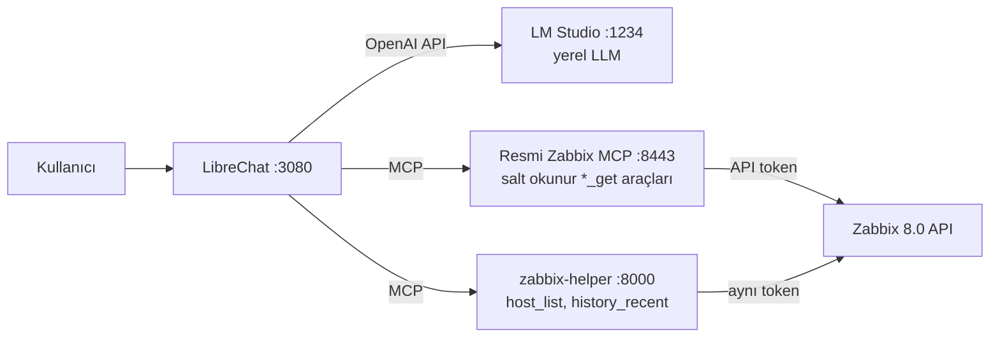

# Zabbix MCP + yerel LLM

[English](README.md) · **Türkçe**

Zabbix'e kendi bilgisayarında çalışan küçük bir dil modeliyle, günlük dilde soru sor. Bulut
yok, API faturası yok. Bu repoda şunlar var:

- **Docker yığını**: Zabbix 8.0, **resmi Zabbix MCP sunucusu** ve LM Studio'daki modele
  bağlı LibreChat
- **zabbix-helper**: 4B'lik modellerin **doğru ve hızlı** cevap verebilmesi için yazdığım
  küçük bir MCP sunucusu
- bunu ölçen, cevapları Zabbix API'ye karşı otomatik puanlayan **tekrarlanabilir bir test**



## Neden gerek oldu

Zabbix 8.0 ile resmi bir MCP sunucusu geliyor. Çalışıyor, ama küçük bir yerel modelle
(MacBook Pro M4, 16 GB RAM üzerinde test edildi) cevaplar yanlış, boş ya da dakikalar sürüyordu:

| Sorun | Ne oldu |
|---|---|
| **Unix zaman damgası** | `history_get`, `time_from` / `time_till` değerlerini Unix zamanı olarak istiyor. Qwen3.5 4B tarihi biliyordu (`2026-11-06T12:33Z`) ama bunu `1732068549`'a çevirdi; bu **Kasım 2024** demek. Zabbix "7 günden eski olamaz" diye reddetti, model de aynı yanlış hesabı 4 dakika boyunca tekrarladı. |
| **Dev araç cevapları** | `host_get` her host'u tüm trigger'larıyla döndürüyor: 83 trigger'lı **tek bir host bile ~16 KB (~4.500 token)**. `MaxResponseSize=16K` iken sonuç boş geldi ve model "0 host var" dedi. 32K'ya ise ancak 2 host sığıyor. |
| **Sayıyı yanlış yorumlama** | Model ham ortalama `0.8166` değerini **"%81.66"** diye okudu. |
| **Büyük bağlamda kaybolma** | Host ID vermeden item araması template item'larını da getiriyor (65 sonuç, ~15 bin token). Model sonra 6.000 token düşündü ve hiçbir şey döndürmedi. |

Bunlar talimatla çözülecek sorunlar değil: 4B'lik bir model tarih hesabını ve ortalamayı
güvenilir yapamıyor; araç ne kadar çok token döndürürse yolunu kaybetme ihtimali o kadar artıyor.

## Çözüm: zabbix-helper

Modelin yapamadığı işi kendisi yapan ve kısa, olduğu gibi aktarılabilecek cevaplar dönen
yaklaşık 200 satırlık bir MCP sunucusu ([`zabbix-helper/server.py`](zabbix-helper/server.py)):

| Araç | Neyin yerine | Ne yapıyor |
|---|---|---|
| `host_list` | `host_get` | Sadece ID, ad, durum ve agent erişilebilirliği döndürüyor (~16.000 yerine ~200 karakter). Host ekledikçe bozulmuyor. |
| `history_recent` | `history_get` | Model sadece "son 60 dakika" diyor. Zaman aralığını, değer tipini sunucu buluyor ve **en düşük / ortalama / en yüksek / son** değeri birimiyle döndürüyor (`"0.78 %"`, `"6.34 GB"`). |

Tasarım kararları:

- **Token saklamaz.** İstemcinin `Authorization: Bearer` başlığını Zabbix API'ye iletir;
  böylece Zabbix, resmi MCP sunucusundaki aynı salt okunur yetkileri uygular.
- **Zabbix API'yi doğrudan çağırır**, bu yüzden MCP sunucusunun cevap boyutu sınırına takılmaz.
- Resmi Zabbix MCP sunucusu diğer her şey için (problemler, trigger'lar, item'lar) yerinde kalıyor.

## Sonuçlar

Aynı dört soru, aynı agent talimatları. Tek fark araç seti: **official** modele resmi MCP
araçlarını veriyor; **helper** ise `host_get` / `history_get` yerine `host_list` /
`history_recent` kullanıyor.

- **Geçmiş değer soruları** (son 1 saatin CPU'su, son 24 saatin belleği): resmi araçlarla hiçbir
  model tek bir soruyu bile doğru cevaplayamadı. zabbix-helper ile **16 sorudan 9'u** doğru.
- **Qwen3.5 4B**: **6/12'den 10/12'ye** çıktı; soru başına medyan süre **73 sn'den 13 sn'ye** indi.
- Host sayısı ve aktif problem sorularında iki araç setiyle de her seferinde doğru cevap geldi.
  Basit sorgularda resmi sunucu gayet iyi.

| Model | Araç seti | Host sayısı | Aktif problem | CPU, son 1 saat | Bellek, son 24 saat | Toplam | Medyan süre |
|---|---|---|---|---|---|---|---|
| Qwen3.5 4B | official | 3/3 (27 sn) | 3/3 (13 sn) | 0/3 (117 sn) | 0/3 (172 sn) | **6/12** | 73 sn |
| Qwen3.5 4B | **helper** | 3/3 (7 sn) | 3/3 (8 sn) | 2/3 (79 sn) | 2/3 (20 sn) | **10/12** | **13 sn** |
| Qwen3 4B 2507 | official | 2/2 (21 sn) | 2/2 (7 sn) | 0/2 (32 sn) | 0/2 (33 sn) | **4/8** | 22 sn |
| Qwen3 4B 2507 | **helper** | 2/2 (7 sn) | 2/2 (6 sn) | 0/2 (8 sn) | 2/2 (12 sn) | **6/8** | 7 sn |
| Qwen3 4B Thinking 2507 | official | 1/1 (81 sn) | 1/1 (48 sn) | 0/1 (240 sn) | 0/1 (240 sn) | **2/4** | 160 sn |
| Qwen3 4B Thinking 2507 | **helper** | 1/1 (38 sn) | 1/1 (54 sn) | 0/1 (170 sn) | 0/1 (198 sn) | **2/4** | 112 sn |
| Gemma 4 12B | official | 2/2 (103 sn) | 2/2 (36 sn) | 0/2 (240 sn) | 0/2 (240 sn) | **4/8** | 180 sn |
| Gemma 4 12B | **helper** | 2/2 (35 sn) | 2/2 (29 sn) | 1/2 (85 sn) | 2/2 (63 sn) | **7/8** | 48 sn |

Hücrelerde *doğru / deneme (medyan saniye)* yazıyor. Her sorunun süre sınırı 240 sn.

**Resmi araçlarla nasıl başarısız oldu?** Modeller yanlış Unix zaman damgası hesapladı ve
`history_get` bunları reddetti. Ya da token bütçesi bitene kadar düşündü (bazen hiç araç
çağırmadan) ve hiçbir şey döndürmedi (Qwen3.5 4B: 5 kez cevapsız). Bazıları 240 sn sınırına takıldı (Gemma ve Qwen3
Thinking: 6 kez). Qwen3 4B 2507 hızlı ama yanlış cevap verdi; bir seferinde **değerleri uydurdu**
("ortalama %45.2"; gerçek değer %0.71).

**zabbix-helper ile hâlâ nasıl başarısız oluyor?** Kalan 7 hatanın hepsi geçmiş veri okunmadan
*önce*, item seçilirken oluyor:

- Qwen3 4B 2507 "CPU usage" diye aradı, ama item'ın adı "CPU utilization". Bir şey bulamayınca
  vazgeçti (2 kez).
- Qwen3 4B Thinking `item_get`'i `limit: 1` ile çağırıp ilk sonucu kullandı: *CPU guest nice
  time* ve *Available memory*. Değerler doğruydu ama yanlış metriğe aitti (2 kez).
- Qwen3.5 4B talimata rağmen `item_get`'i `hostids` olmadan çağırdı. Verisi olmayan template
  item'ları geldi ve "veri yok" dedi ya da hiç cevap vermedi (2 kez).
- Gemma doğru item'ı seçti ve en yüksek değeri birebir verdi, ama ortalaması %0.96 çıktı (doğrusu
  %0.88).¹

"CPU" ya da "bellek" ifadesini host'un doğru item'ıyla eşleştiren bir araç, açık ara sıradaki adım.

**Öneri:** En yüksek puanı alan ve en hızlı olan, zabbix-helper ile Qwen3.5 4B. Gemma 4 12B
neredeyse aynı doğrulukta (7/8), ama yaklaşık 4 kat yavaş ve 3.1 GB yerine 6.8 GB RAM kullanıyor.

<details>
<summary>Test ortamı</summary>

- MacBook Pro M4, 16 GB RAM; LM Studio, MLX runtime; tüm modeller MLX 4-bit
- Bağlam: 4B modellerde 32K, Gemma 4 12B'de 16K (16 GB'lık makinede Docker'a bellek kalsın diye)
- Araç seti başına deneme: 3 (Qwen3.5 4B), 2 (Qwen3 4B 2507, Gemma), 1 (Qwen3 Thinking)
- Soru başına: en fazla 8 araç çağrısı turu, model cevabı başına 4.096 token, toplam 240 sn
- Zabbix 8.0.0, tek host (*Zabbix server*, kendini izliyor), aktif problem yok; 2026-11-06'da çalıştırıldı
- Ham sonuçlar: [`bench/results/20261106-160552.jsonl`](bench/results/20261106-160552.jsonl)

¹ Test sırasında Mac bir kez uykuya geçti. Uyku sırasında çalışan kayıt (8.367 sn görünen bir
süre aşımı) yeniden çalıştırıldı ve yine süre aşımına uğradı. Yukarıdaki Gemma CPU hatası,
uyanmanın hemen ardından çalıştı; o anda son bir saatte yalnızca 4 ölçüm vardı. Bu durumda tek
bir yeni ölçüm bile ortalamayı %8'lik toleranstan fazla kaydırabilir. Yine de hata olarak sayıldı.

</details>

## Yol boyunca bulunan diğer tuzaklar

Dokümandan anlaşılmayan ve zaman kaybettiren şeyler:

1. **Zabbix 8.0'da varsayılan rollerde API erişimi kapalı.** Hazır *User role* ve *Admin role*
   `No permissions to call "host.get"` hatası veriyor. [`setup_zabbix.py`](setup_zabbix.py),
   sadece MCP araçlarının kullandığı 12 okuma metoduna izin veren bir rol oluşturuyor.
2. **Zabbix 8.0'da `hostinterface.update` yok.** Arayüzler `host.update` ile, `interfaces`
   dizisi verilerek değiştiriliyor.
3. **LibreChat, Bearer token kullanan MCP sunucusunu OAuth sanıyor.** Başlıksız ilk kontrolde
   `401` alıyor, `OAuth Required: true` yazıyor ve hiç araç yüklemiyor. Çözüm:
   `requiresOAuth: false`.
4. **LibreChat'in SSRF koruması özel ağdaki MCP sunucularını engelliyor.** Bunları
   `mcpSettings.allowedAddresses` altına `host:port` olarak ekle.
5. **Zabbix MCP Docker imajı numaralı araç kuralları kullanıyor**: `ZBX_ALLOWTOOL_REGEXP_0`,
   `ZBX_DENYTOOL_1`, ... (tek ortak sıra, boşluk olmadan). Docker Compose'da regexp içindeki
   `$`, `$$` olarak yazılmalı.
6. **`ZBX_MAX_RESPONSE_SIZE=16K`, çok trigger'lı bir host'ta `host_get`'i sessizce boşaltıyor**:
   cevap `truncated: true` ve sıfır sonuç dönüyor, modeller de "0 host" diyor.
7. **Küçük modellerin bugünün tarihine ihtiyacı var.** LibreChat, agent talimatlarındaki
   `{{iso_datetime}}` değişkenini her mesajda gerçek tarihle değiştiriyor.

## Hızlı başlangıç

Gerekenler: Docker (macOS'ta OrbStack ile test edildi), Python 3 ve yerel sunucusu 1234
portunda açık [LM Studio](https://lmstudio.ai).

```bash
git clone https://github.com/enderkus/zabbix-mcp-local-llm.git
cd zabbix-mcp-local-llm

# 1. Yapılandırma: şifreleri doldur (openssl komutları dosyaların içinde)
cp .env.example .env
cp librechat.env.example librechat.env

# 2. Zabbix'i, resmi MCP sunucusunu ve zabbix-helper'ı başlat
docker compose up -d zabbix-db zabbix-server zabbix-web zabbix-agent zabbix-mcp zabbix-helper

# 3. Salt okunur mcp-reader kullanıcısını, rolünü ve API token'ını oluştur (librechat.env'e yazılır)
python3 -I setup_zabbix.py

# 4. LibreChat'i başlat
docker compose up -d librechat
```

Sonra:

1. **LM Studio**'da `qwen3.5-4b-mlx` modelini (Qwen3.5 4B, MLX 4-bit) **32K bağlamla** yükle.
2. http://localhost:3080 adresinde kayıt ol; ilk kullanıcı admin olur. Ardından
   `librechat.env` içinde `ALLOW_REGISTRATION=false` yap ve `docker compose up -d librechat` çalıştır.
3. LibreChat'te bir **agent** oluştur:
   - Model: *LM Studio* → `qwen3.5-4b-mlx`
   - Araçlar: **zabbix-helper**'dan `host_list` ve `history_recent`; **zabbix**'ten `item_get`,
     `problem_get` ve `trigger_get`
   - Talimatlar (testte kullanılan):

     ```
     Sen bir Zabbix asistanısın. Şu anki tarih ve saat: {{iso_datetime}}.
     - Zabbix ile ilgili her soruda önce araç çağır, asla tahmin etme.
     - Host saymak, listelemek veya host ID bulmak için host_list kullan. item_get'i her zaman hostids ile çağır.
     - Geçmiş değer sorularında (son 1 saat, son 1 gün gibi) history_recent kullan; zaman damgası hesaplama.
     - Trigger tanımlarını problem gibi sunma; aktif problemler için problem_get kullan.
     - Cevapları kısa ve Türkçe ver.
     ```

## Testi tekrarlamak

```bash
# tek model ve araç seti (model LM Studio'da yüklü olmalı)
python3 -I bench/run_bench.py --model qwen3.5-4b-mlx --toolset helper --runs 3

# tüm matris: modelleri lms ile sırayla yükler, sonunda özet tabloyu basar
bash bench/run_all.sh

# mevcut sonuçların özet tablosu
python3 -I bench/run_bench.py --report bench/results/*.jsonl
```

Her soru, araç tanımları ve yukarıdaki agent talimatlarıyla birlikte gönderiliyor. Araç
çağrıları gerçekten yapılıyor; son cevap, testten hemen sonra Zabbix API'den okunan değerlerle
puanlanıyor (host sayısı ve adları; "problem yok"; ortalama **ve** en yüksek değer ±%8 içinde).
Her araç çağrısını ve cevabı içeren ham sonuçlar [`bench/results/`](bench/results/) klasöründe.

## Güvenlik notları

- Her şey **salt okunur**: MCP sunucusu sadece `*_get` araçlarını açıyor; token'ın sahibi olan
  kullanıcının rolü sadece 12 okuma API metoduna izin veriyor. zabbix-helper da aynı token'ı kullanıyor.
- MCP portları `127.0.0.1`'e bağlı; `BIND_ADDR` değiştirilmedikçe web arayüzleri de.
- Bir şeyi dışarı açmadan önce **Zabbix'in `Admin` / `zabbix` şifresini değiştir**.
- Şifreler git'e girmeyen `.env` ve `librechat.env` dosyalarında.

## Sınırlar

- Tek bir makinede (MacBook Pro M4, 16 GB) ve sadece kendini izleyen bir test Zabbix'inde
  denendi. Farklı donanımda ve çok host'lu gerçek ortamlarda sayılar farklı olacaktır.
- 4B'lik bir model yine de hata yapabilir. Önemli değerleri Zabbix arayüzünde
  (*Monitoring → Latest data*) kontrol et.
- zabbix-helper resmi bir Zabbix bileşeni değil; gelecekteki Zabbix API değişiklikleri için
  güncellenmesi gerekebilir.

## Lisans

[MIT](LICENSE) © 2026 Ender KUŞ
